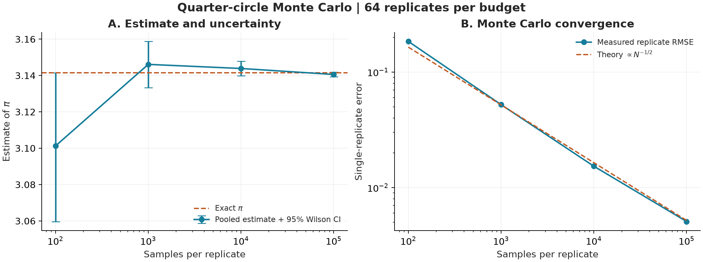

# HPC Monte Carlo Workflow

[](https://github.com/ka784-jpg/HPC-Monte-Carlo-Workflow/actions/workflows/tests.yml)
[](LICENSE)
[](pyproject.toml)

A small, end-to-end scientific computing workflow: define an experiment, run independent Monte Carlo tasks on a laptop or a Slurm cluster, resume interrupted work, validate every result, and produce uncertainty-aware plots.

The example estimates **pi from random points in a square**. Its exact answer makes correctness and convergence easy to inspect. The simulation and workflow use only the Python standard library; Matplotlib is optional for plotting.

[Quickstart](#quickstart) | [Example results](docs/RESULTS.md) | [Workflow design](docs/WORKFLOW.md) | [Slurm guide](docs/SLURM.md) | [CLI reference](docs/CLI.md)



**An executable example, not an illustrative mockup.** This figure is generated from the included configuration and seeds: 256 tasks and 7,110,400 sampled points. The left panel pools 64 independent seeded replicates at each budget; the right compares single-replicate error with its analytical prediction. [Data, interpretation, and reproduction commands](docs/RESULTS.md).

## Quickstart

Requires Python 3.11 or later. From a terminal:

```bash
git clone https://github.com/ka784-jpg/HPC-Monte-Carlo-Workflow.git
cd HPC-Monte-Carlo-Workflow
python -m venv .venv
```

Activate with `source .venv/bin/activate` on Linux/macOS, or `.venv\Scripts\Activate.ps1` in Windows PowerShell. If activation is restricted, invoke the environment's Python directly.

```bash
python -m pip install -e ".[plots]"
python -m mcflow init configs/quickstart.json runs/demo
python -m mcflow run runs/demo
python -m mcflow status runs/demo
python -m mcflow aggregate runs/demo
python -m mcflow plot runs/demo
```

This runs eight tasks totaling 44,000 points. Outputs are in `runs/demo/analysis/`: `tasks.csv`, a checksummed `summary.json`, and `convergence.png` / `convergence.pdf`. Repeating `run` validates and skips finished tasks. Use a new run directory for a changed configuration.

For the larger figure above:

```bash
python examples/reproduce.py --workers 2
```

Use `--workers 1` on a single-core machine. The core workflow also installs without plotting dependencies: `python -m pip install -e .`.

## What This Demonstrates

| Concern | Implementation |
| --- | --- |
| Reproducibility | Frozen manifest; deterministic seed per sample budget and replicate |
| Parallel execution | Local processes or one task per Slurm array element |
| Interrupted jobs | Checkpointed hit count, sample count, and complete RNG state |
| Duplicate execution | Per-task exclusive lock; validated completed tasks are skipped |
| Data integrity | Atomic file replacement, SHA-256 checksums, identity/count checks |
| Resource discipline | Explicit worker limits, free-space checks, Slurm CPU/memory/time requests |
| Recovery | Regenerate a Slurm array containing only unfinished task IDs |
| Analysis | Reject incomplete/invalid collections; Wilson confidence intervals and convergence plots |

The batch-script generator **never submits jobs**. Review its output and submit explicitly. See the [Slurm walkthrough](docs/SLURM.md).

## Test It

```bash
python -m unittest discover -s tests -v
```

Tests cover deterministic seeds, serial/parallel agreement, exact checkpoint replay, damaged records, missing outputs, duplicate locks, low disk space, atomic-write failures, statistical boundaries, and plotting. A POSIX-only test sends SIGTERM to a real worker and verifies its resumed result. CI runs on Linux and Windows with Python 3.11-3.14.

## Scope

This is a self-contained demonstration of reproducible batch simulation. It contains no private research code, unpublished research results, cluster credentials, or institution-specific configuration. All checked-in figures come from the public toy model in this repository.

It is **not** a production scheduler, a distributed database, a performance benchmark, or an efficient way to calculate pi. Site quotas, scheduler accounting, and catastrophic filesystem failures still require operational judgment. [Guarantees and limitations](docs/WORKFLOW.md#guarantees-and-limits).

## Repository Map

```text
configs/             Small example and reproducible figure configuration
src/mcflow/          Simulation, execution, validation, CLI, and plotting
examples/            One-command reproduction of the documented figure
tests/               Unit, integration, fault-injection, and rendering tests
docs/                Results, workflow design, CLI, and cluster walkthrough
.github/workflows/   Cross-platform continuous integration
```

Code, documentation, and the generated demonstration figures are available under the [MIT license](LICENSE). Contributions are welcome; see [CONTRIBUTING.md](CONTRIBUTING.md).
